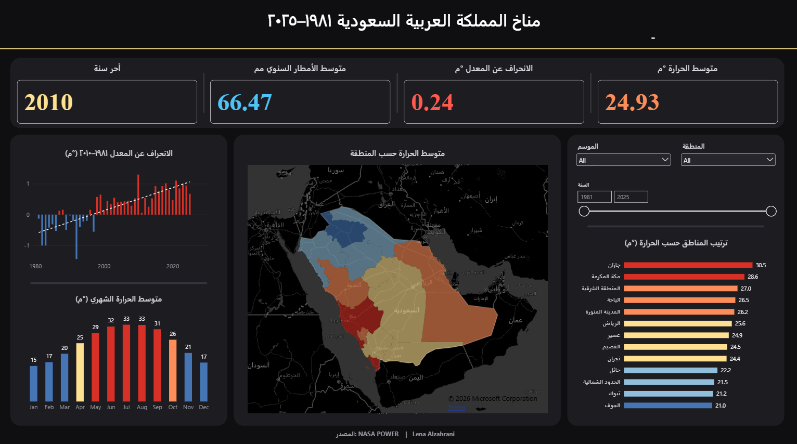

# 🌡️ Saudi Climate Dashboard 1981–2025 | لوحة مناخ المملكة العربية السعودية



An interactive **Power BI** dashboard analyzing 45 years of climate data across Saudi Arabia's **13 administrative regions**, built from **NASA POWER** data.

لوحة تفاعلية في **Power BI** تحلل ٤٥ سنة من بيانات المناخ في **المناطق الإدارية الـ١٣** بالمملكة، مبنية على بيانات **NASA POWER**.

---

## 📊 Key insights | أبرز النتائج

- Until the late 1990s most years were **cooler** than the 1981–2010 baseline; since then almost every year has been **warmer**.
- **Jazan** is the hottest region (30.5 °C average) and **Al-Jouf** the coolest (21.0 °C).
- **2010** was the hottest year of the period.

---

- حتى نهاية التسعينات كانت أغلب السنوات **أبرد** من معدل ١٩٨١–٢٠١٠، ومن بعدها صارت كلها تقريباً **أحر** منه.
- **جازان** الأعلى حرارة بمتوسط ٣٠.٥°م، و**الجوف** الأبرد بمتوسط ٢١°م.
- **٢٠١٠** كانت أحر سنة في الفترة كاملة.

---

## 🧩 Dashboard features | مكونات اللوحة

| Visual | Description |
|---|---|
| KPI cards | Average temperature, anomaly, annual rainfall, hottest year |
| Filled region map | Each region colored by average temperature (blue → red) |
| Anomaly columns | Yearly deviation from the 1981–2010 baseline (red = warmer, blue = cooler) with trend line |
| Monthly profile | Average temperature by month |
| Region ranking | Regions ordered from hottest to coolest |
| Slicers | Region, season, year range |

---

## 🛠️ Tech stack | الأدوات

- **Python** (`requests`, `pandas`): automated download from the NASA POWER API
- **Power BI**: data model (star schema), DAX measures, conditional formatting, custom theme

---

## 📁 Repository structure

```
├── saudi_climate_download.py   # data download script (NASA POWER API)
├── dashboard.png               # dashboard screenshot
└── README.md
```

## ▶️ How to run

1. `pip install requests pandas`
2. `python saudi_climate_download.py` → generates `climate_monthly.csv` and `regions.csv`
3. Load both CSV files into **Power BI Desktop** and relate them on `region_id`

---

## ⚠️ Notes | ملاحظات

- Each region is represented by a single point at its administrative capital (NASA POWER resolution ≈ 0.5°, ~50 km), so mountainous regions such as Asir and Al-Bahah may appear warmer than local reality.
- This is a personal learning project and is not an official product of any organization.

- كل منطقة ممثلة بنقطة عند عاصمتها الإدارية (دقة البيانات تقريباً ٥٠ كم).
- هذا مشروع تعلم شخصي، وليس منتجاً رسمياً لأي جهة.

---

**Data source:** [NASA POWER](https://power.larc.nasa.gov/)

**Developed by Lena Alzahrani** — Geospatial Applications Officer | مسؤولة تطبيقات جيومكانية
